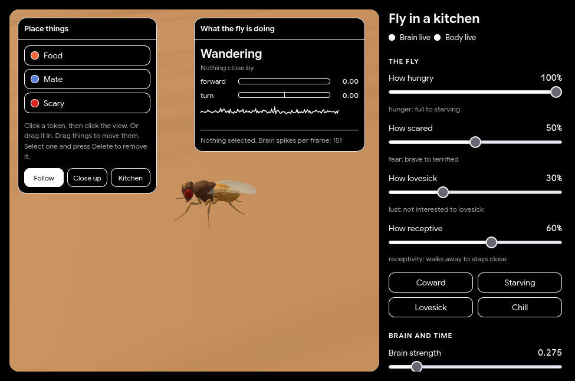
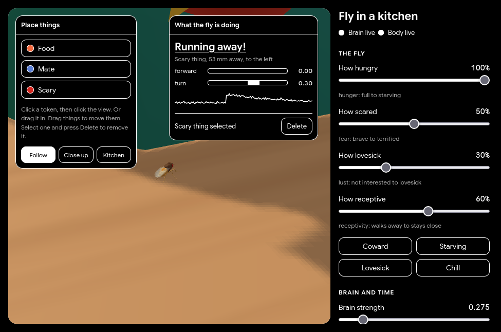
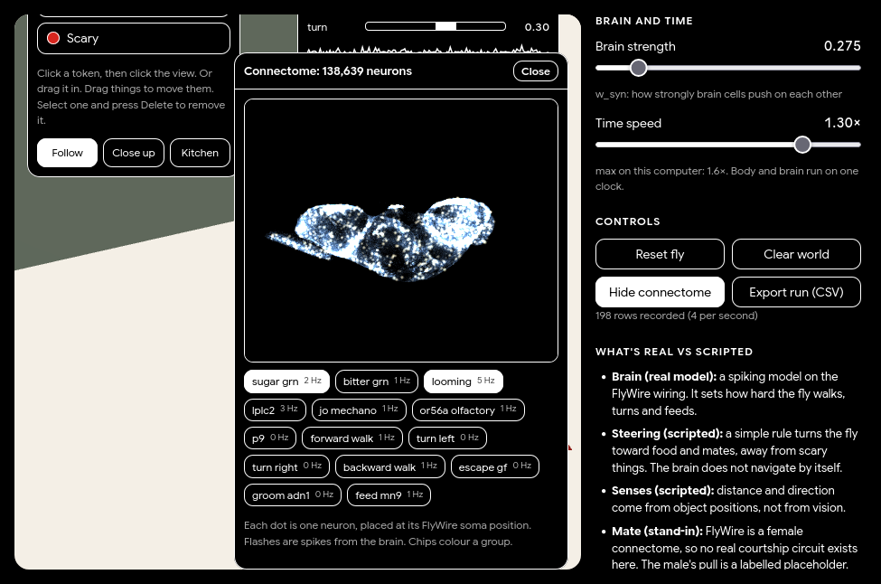

# flybrain

flybrain puts a leaky integrate-and-fire model of the adult fruit fly brain, built from the FlyWire connectome, into a
walking NeuroMechFly body in a 3D kitchen. You can place food, a mate and a scary object in the scene, tune how hungry,
scared, lovesick and receptive the fly is, and watch the connectome spike while it reacts.



**Status: a research demo.** It is an exploration and teaching tool, not a validated model of fly behaviour.
Read [What is real and what is scripted](#what-is-real-and-what-is-scripted) before drawing conclusions.

## Quick start

Linux with Docker Engine and the Compose v2 plugin:

```bash
git clone https://github.com/hamb1y/flybrain.git && cd flybrain && ./install.sh
```

Then open **http://127.0.0.1:5030**.

`install.sh` can be re-run safely. It:

1. checks that Docker and `docker compose` work;
2. downloads the four connectome files (about 136 MB) from their public sources and checks each one against
   `data/SHA256SUMS`. Files that are already present and match are skipped;
3. uses the NVIDIA GPU for the brain if Docker can give containers access to it, otherwise the CPU;
4. builds and starts the three containers and prints the URL.

Dry run, with no downloads and no builds: `./install.sh --check` tests the source URLs, verifies `data/` and reports the
Docker and GPU status. Force a mode with `--cpu` or `--gpu`.

Stop with `docker compose down`. Logs: `docker compose logs -f`.

## Screenshots

| Fleeing from a scary object | Connectome view (every dot is a neuron) |
|---|---|
|  |  |

## Requirements

- **Linux with Docker Engine** and Compose v2. The stack uses host networking. Docker Desktop (macOS, Windows) is not tested.
- **Disk:** about 136 MB of data. Images: about 3 GB for the CPU stack, about 9 GB with the CUDA brain.
- **Memory:** not measured. The brain keeps the 15.1-million-synapse connectome in RAM.
- **GPU (optional):** an NVIDIA driver plus the NVIDIA container toolkit configured for Docker. Without it everything runs
  on the CPU.

## Speed

| Brain on | Speed (simulated time / wall time) |
|---|---|
| 8-core CPU | about 0.25x to 1x real time, depending on how much is stimulated |
| NVIDIA GPU (RTX 5070 Ti) | about 8x real time |

The walking body runs at about real time on one CPU core. The "Time speed" slider in the UI is capped at the maximum
this computer can sustain.

## Ports

| Port | Service | Notes |
|---|---|---|
| 5030 | web | the UI. Open this one. |
| 5031 | brain | HTTP API, WebSocket `/stream` |
| 5032 | physics | HTTP API, WebSocket `/stream` |

All three are bound to 127.0.0.1.

## Architecture

```
browser ──► web :5030  (SvelteKit + three.js; proxies /api/brain, /api/physics, /ws/*)
               │                          │
               ▼                          ▼
        brain :5031                physics :5032
        connectome LIF             MuJoCo NeuroMechFly body (flygym 2.1.1)
        (CUDA or CPU)              walking controller, senses, rules
               │   WS /stream: motor output, spikes
               └──────────────────────────► │
               ◄── POST /stimulate, PUT /speed, POST /vision ┘
```

- **brain/** (Python, FastAPI): the whole-brain LIF simulation of FlyWire v783, 138,639 neurons and 15.1 million synapses.
  Stimulation is by named neuron group. Motor output is read from descending-neuron groups.
- **physics/** (Python, FastAPI, MuJoCo): the NeuroMechFly v2 body with a tripod-gait controller. It senses objects
  geometrically, runs the behaviour rules and sends stimulation to the brain. It renders eye images for the brain.
- **web/** (SvelteKit, three.js): the UI, the 3D scene and the connectome view. The browser talks only to port 5030.
- **docs/SPEC.md**: the design spec with the contracts between services.
- **reference/**: upstream code the brain follows (see THIRD_PARTY.md).

## What is real and what is scripted

| Part | Status |
|---|---|
| Connectome brain (138,639 neurons, FlyWire v783, Shiu et al. LIF rules) | **Real.** It runs live and its spikes show in the connectome view. |
| Walking speed | **Real brain output.** The brain's forward output sets how fast the fly walks, through the walking neurons. |
| Fleeing turn | **Partly real.** A scary object drives the looming (LC4) and LPLC2 neurons on its side. While the fly flees, the brain's turn output steers it. The decision to flee is a rule. |
| Smell | **Real neurons.** Food odour is converted to rates for the FlyWire olfactory receptor groups (ORN groups). |
| Vision | **Rendered, not used for looming.** Both eyes are rendered (661 ommatidia each) and the image is sent to the photoreceptors. In measurements the photoreceptor input did not produce a looming response, so fleeing still comes from the rule. |
| Steering toward food and mates, eating, hunger, choosing between fear, lust and hunger | **Scripted rules.** |
| Mate | **Stand-in.** FlyWire is a female connectome and the body is female, so there is no real courtship circuit. The mate is a labelled placeholder. |
| The fly | **Female**, as in FlyWire and the NeuroMechFly body. |
| Flight | **Not possible.** The body walks. |
| Kitchen | Procedural scene, no 3D assets. |

## Controls

- **Place things:** click Food, Mate or Scary, then click the view. Or drag a token into the view.
- **Move things:** drag any object on the table. Select it and press Delete to remove it. Esc clears the armed token and the selection.
- **Camera:** Follow, Close up, Kitchen.
- **The fly:** sliders for how hungry, how scared, how lovesick and how receptive it is. Presets: Coward, Starving,
  Lovesick, Chill.
- **Brain and time:** Brain strength (the global synaptic weight, `w_syn`), Time speed (0.1x to 2x, capped at the maximum
  this computer sustains).
- **Controls:** Reset fly, Clear world, Show connectome, Export run (CSV).
- **Advanced (for scientists):** every brain parameter and neuron group.
- **Connectome view:** every dot is one neuron at its FlyWire soma position. Flashes are spikes. Chips colour a group.

The 3D view pauses while the browser tab is hidden. Keep the tab in front.

## Troubleshooting

- **`permission denied` on the Docker socket:** add your user to the docker group
  (`sudo usermod -aG docker $USER`, then log out and back in), or run `sudo ./install.sh`.
- **The installer says Docker cannot give containers the GPU:** the host sees the GPU, but Docker has no GPU runtime.
  Install the NVIDIA container toolkit, run `sudo nvidia-ctk runtime configure --runtime=docker` and restart Docker,
  then run `./install.sh --gpu`. Without this the CPU brain is used and everything still works.
- **A checksum mismatch:** the installer refuses the file and deletes the download. Re-run it. If it keeps failing,
  check for a proxy or captive portal that changes downloads.
- **The brain is not healthy after a few minutes:** check `docker compose logs brain`. The first start builds caches
  from the connectome.
- **The brain runs slowly:** lower Time speed. The slider shows the maximum this computer sustains. Stimulating many
  groups at once costs the most.
- **The 3D view freezes:** the tab is hidden. Browsers pause animation in background tabs.
- **Ports 5030 to 5032 are in use:** stop the other program, or stop an earlier stack with `docker compose down`.

## Repository layout

```
install.sh               one-command installer
docker-compose*.yml      stack: base, plus cpu or gpu overlay
brain/ physics/ web/     the three services (each has its own README)
data/                    connectome data, downloaded by install.sh (SHA256SUMS is committed)
docs/SPEC.md             design spec
reference/               upstream code and licenses the brain follows
tools/                   offline tools that build the static files
deploy/                  optional offline image save and start scripts
```

Tests run inside the containers. See `brain/README.md` and `physics/README.md` for the commands.

## Data, licenses and credits

- **Code:** MIT, see [LICENSE](LICENSE), except `brain/` which is GPL-2.0-or-later (it derives from GPL code; see
  [THIRD_PARTY.md](THIRD_PARTY.md)).
- **Data:** not redistributed. `install.sh` downloads it from public sources at pinned commits. FlyWire's guidelines state
  that its public release data is CC BY-NC 4.0. Check the terms before reuse. Sources, licenses and checksums are in
  [THIRD_PARTY.md](THIRD_PARTY.md).
- **Credits:** the FlyWire team (Dorkenwald et al. 2024), the Shiu et al. 2024 whole-brain model, the flywire_annotations
  authors, the NeuroMechFly and flygym teams (Lobato-Rios et al. 2022), and the authors of rjo6615/fly-brain-interactive
  and eonsystemspbc/fly-brain. Also three.js, SvelteKit, FastAPI, PyTorch and MuJoCo.
- Parts of the code were written with AI assistance.

If you use this work, cite Shiu et al. (2024), Dorkenwald et al. (2024) and Lobato-Rios et al. (2022).
